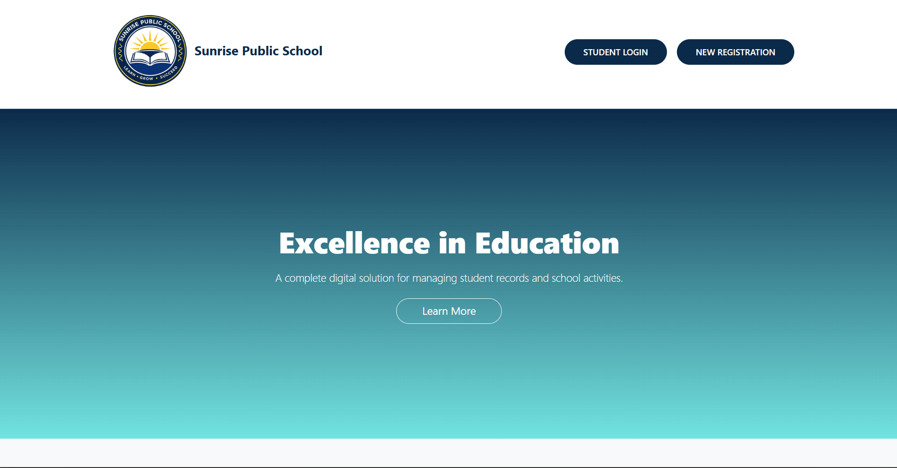
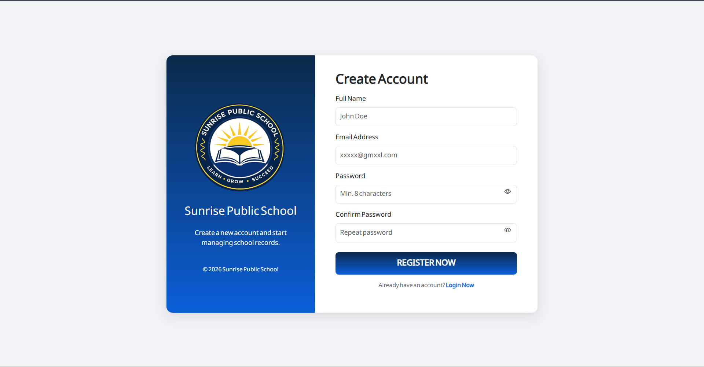
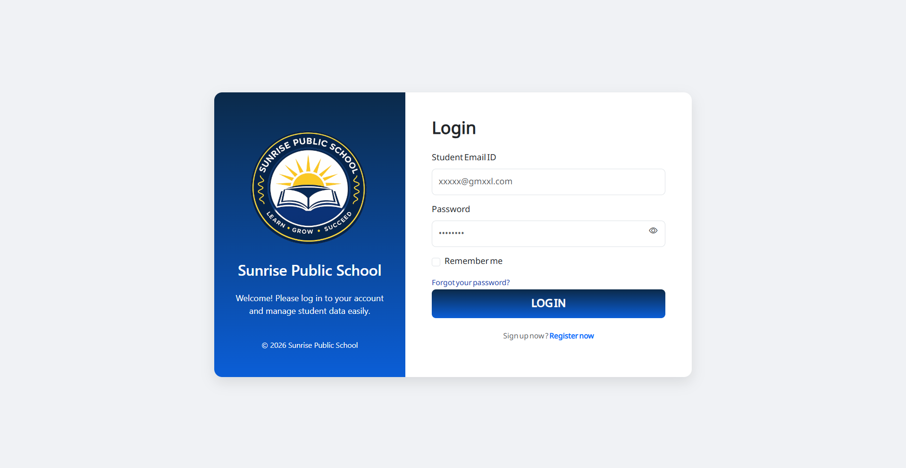
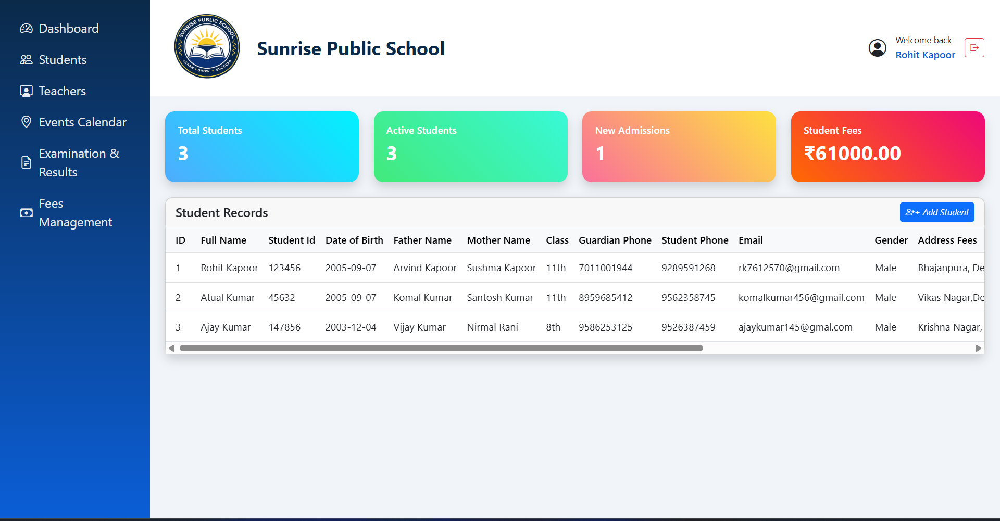
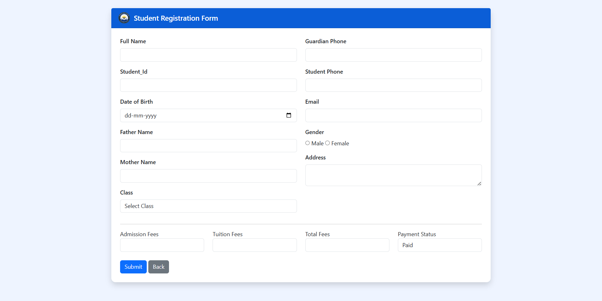
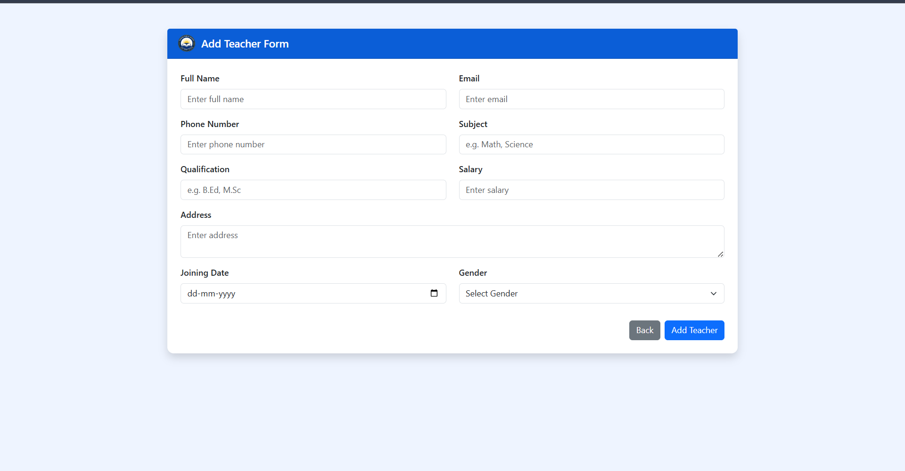
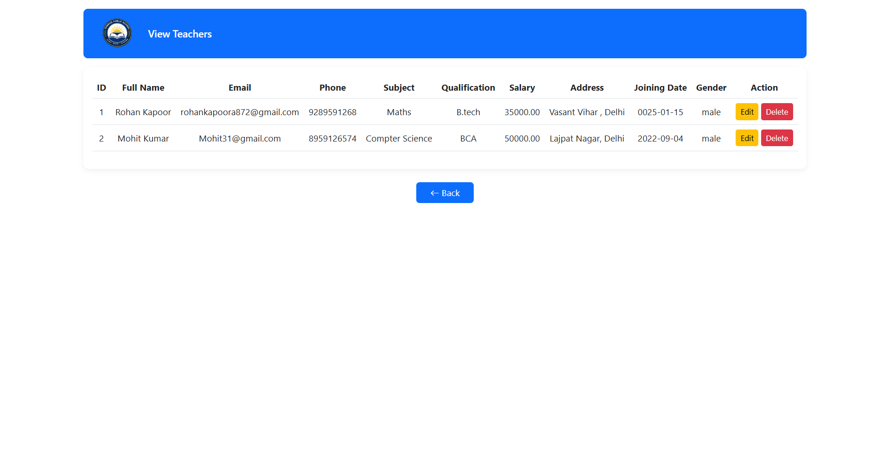
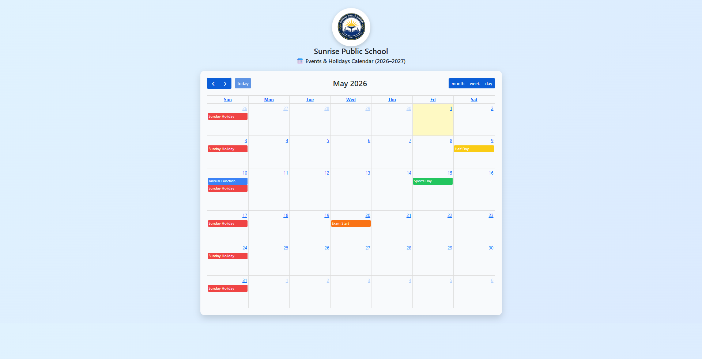
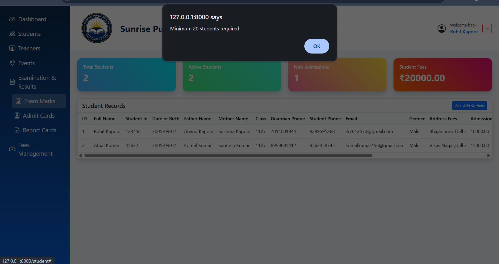
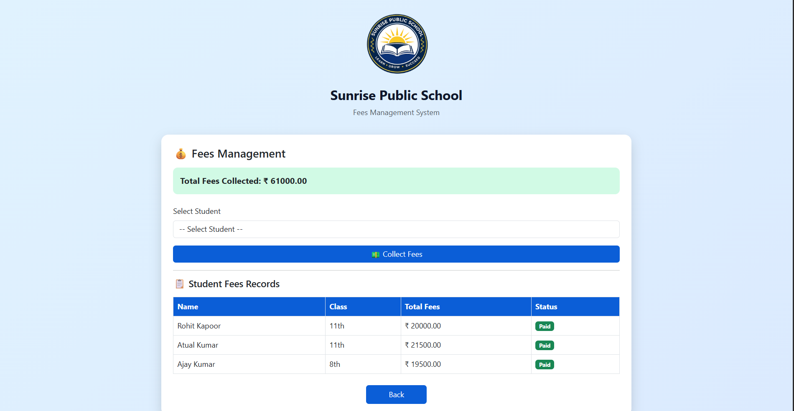

<<<<<<< HEAD

## About Laravel

Laravel is a web application framework with expressive, elegant syntax. We believe development must be an enjoyable and creative experience to be truly fulfilling. Laravel takes the pain out of development by easing common tasks used in many web projects, such as:

- [Simple, fast routing engine](https://laravel.com/docs/routing).
- [Powerful dependency injection container](https://laravel.com/docs/container).
- Multiple back-ends for [session](https://laravel.com/docs/session) and [cache](https://laravel.com/docs/cache) storage.
- Expressive, intuitive [database ORM](https://laravel.com/docs/eloquent).
- Database agnostic [schema migrations](https://laravel.com/docs/migrations).
- [Robust background job processing](https://laravel.com/docs/queues).
- [Real-time event broadcasting](https://laravel.com/docs/broadcasting).

Laravel is accessible, powerful, and provides tools required for large, robust applications.

## Learning Laravel

Laravel has the most extensive and thorough [documentation](https://laravel.com/docs) and video tutorial library of all modern web application frameworks, making it a breeze to get started with the framework. You can also check out [Laravel Learn](https://laravel.com/learn), where you will be guided through building a modern Laravel application.

If you don't feel like reading, [Laracasts](https://laracasts.com) can help. Laracasts contains thousands of video tutorials on a range of topics including Laravel, modern PHP, unit testing, and JavaScript. Boost your skills by digging into our comprehensive video library.

## Laravel Sponsors

We would like to extend our thanks to the following sponsors for funding Laravel development. If you are interested in becoming a sponsor, please visit the [Laravel Partners program](https://partners.laravel.com).

### Premium Partners

- **[Vehikl](https://vehikl.com)**
- **[Tighten Co.](https://tighten.co)**
- **[Kirschbaum Development Group](https://kirschbaumdevelopment.com)**
- **[64 Robots](https://64robots.com)**
- **[Curotec](https://www.curotec.com/services/technologies/laravel)**
- **[DevSquad](https://devsquad.com/hire-laravel-developers)**
- **[Redberry](https://redberry.international/laravel-development)**
- **[Active Logic](https://activelogic.com)**

## Contributing

Thank you for considering contributing to the Laravel framework! The contribution guide can be found in the [Laravel documentation](https://laravel.com/docs/contributions).

## Code of Conduct

In order to ensure that the Laravel community is welcoming to all, please review and abide by the [Code of Conduct](https://laravel.com/docs/contributions#code-of-conduct).

## Security Vulnerabilities

If you discover a security vulnerability within Laravel, please send an e-mail to Taylor Otwell via [taylor@laravel.com](mailto:taylor@laravel.com). All security vulnerabilities will be promptly addressed.

## License

The Laravel framework is open-sourced software licensed under the [MIT license](https://opensource.org/licenses/MIT).
=======
<h1> Student Management Project </h1>

This is project  to mini Student management project. its a examples sunrise public school student register a portal and  submit a basic detail like Full Name and Email id Password. Then After to login a portal Sunrise Public School.

<h2> Tools & Technologies </h2>

The Project utilizes a modern tech stack to ensure scalability and security. Below are the key tools used:

<ul>
    <li>
        Laravel 11 (Backend Framework)
        
Laravel is PHP-based web framework that follows the MVC
        (Model-View-Controller) pattern. It was chosen for its robust
        security features, elegant syntax, and powerful tools like
        “Eloquent” and “Migrations”.

    </li>
    <li>
        MySql (Database).
        
MySql is the most popular open-source relational database. It is
        used in this project to store structured data in tables like ‘Students’,
        ‘teacher’, and ‘users’.

    </li>
    <li>
        Bootstrap 5 (Frontend).
        
Bootstrap is used to design the user interface. It ensured that the
        Student Management System looks professional and works
        perfectly on desktops, Tablets, Mobile phones(Responsiveness’).

    </li>
    <li>
        Eloquent ORM
        
Eloquent is Laravel’s Built-in-tool that allows developers to
        interact with database tables using PHP objects instead of writing
        complex SQL queries.

    </li>
</ul>

    <h2>OUTPUT SEGMENT PROJECT STARTED</h2>
<ul>
    <li>Welcome Page</li>
    <li>Register Page</li>
    <li>Login Page </li>
    <li>Sunrise Public School</li>
    <ul>
        <li>Dashboard.</li>
        <li>Students.</li>
        <li>Teachers.</li>
        <li>Events Calendar.</li>
        <li>Examination & Result.</li>
        <li>Fees Management.</li>
    </ul>
    <li>Logout.</li>
</ul>

 

<h1>Welcome Page</h1>    

This is the landing page of the Sunrise Public School Management portal.it
serves as the main interface for users to navigate through the system.
    

<h1> Resgister Page</h1>    

This is User Registration Page of the System. It allows of new
administrators or Staff members to create a secure account by providing
their basic Detail Full Name, Email, and Password.
    

<h1> Login Page</h1>    

The System uses encrypted password validation to verify user identity
before granting access to the dashboard.
    

<h1> Dashboard </h1>    

Sunrise Public School Dashboard
    

<h1> Student Registration Form </h1>    

This is Student Registration Form and Fill Up Details.
    

<h1> Teacher Registration Form.</h1>    

This is Student Registration Form and Fill Up Details.
    

<h1> View Teachers  </h1>    

This page allows you to view teacher records and edit their details.
    

<h1> Events Calendar. </h1>    

This page displays scheduled event and academic holidays.
    

<h1> Examination & Results. </h1>    

This module displays examination schedules and student results
must be 20 Students active then show results.
    

<h1> Fees Management </h1>    

This Module Manages Student fees records.
    

>>>>>>> 5eb0b51552c5194b5384ae8114d7a60f8a1bb357
